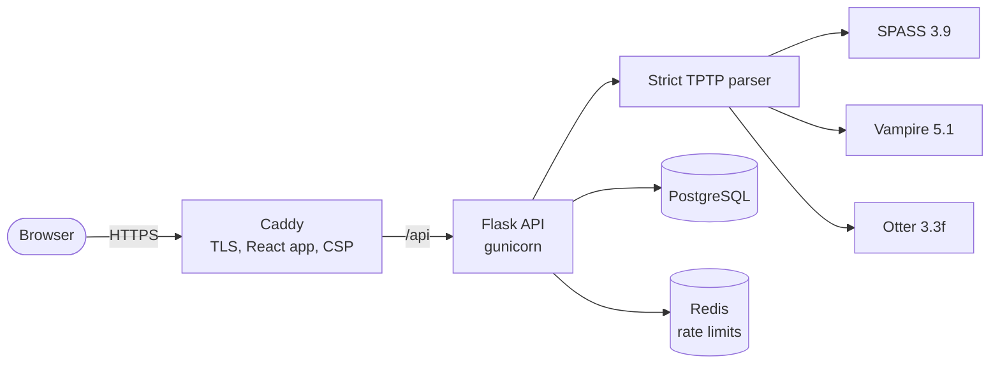

# Formal Verification Platform

A web platform for checking first-order logic problems with three automated theorem provers:
**SPASS**, **Vampire** and **Otter**. Write a problem in TPTP (or pick one from the library of
propositional, first-order, equational and set-theory examples), choose the provers, and compare
their results side by side. Runs and problems are saved per user in PostgreSQL.



## How a verification works

1. The problem is parsed by a strict TPTP (FOF/CNF) parser with size, depth and syntax limits.
   `include` directives, file paths and unsupported syntax are rejected with a line/column message.
2. The syntax tree is re-serialised for each prover: TPTP for SPASS and Vampire, and Otter 3.3 syntax
   for Otter (negated conjecture, explicit quantifiers, Prolog-style variables). Provers only ever
   see text generated by the platform, never the raw input.
3. The selected provers run **in parallel**, each in a sandbox: private temp directory, minimal
   environment, no shell, `prlimit` CPU/memory/file-size/open-file limits, a wall-clock timeout
   that kills the whole process group, and a server-wide cap on concurrent prover processes.
4. Each result is mapped to an SZS status (`Theorem`, `CounterSatisfiable`, `Unsatisfiable`,
   `Satisfiable`, `Timeout`, `GaveUp`, `Error`). The run's verdict combines them, and if provers
   disagree it reports `conflict` rather than picking one.

The test-suite runs every installed prover on every library example and checks that none ever
contradicts the known answer.

| Example domain | Examples |
|---|---|
| Propositional logic | modus ponens, De Morgan, affirming the consequent (counter-satisfiable) |
| First-order logic | Socrates, drinker paradox, quantifier swap (counter-satisfiable), CNF refutation |
| Equational logic | exponent-2 groups are abelian, right identity, groups need not commute |
| Set theory | transitivity of subset, commutativity of intersection |

## Quick start

```bash
python3 scripts/generate_env.py          # .env with random secrets (chmod 600, git-ignored)
docker compose up -d --build --wait      # first build compiles Vampire (~10-15 min)
bash scripts/smoke_test.sh https://localhost
```

Open https://localhost. Caddy uses its local CA for `localhost`, so your browser will ask you to
trust the certificate once. For a real domain, point DNS at the server and run
`python3 scripts/generate_env.py --domain verify.example.com --force`; Caddy then obtains a
Let's Encrypt certificate.

Create an administrator (the password is prompted for, never passed on the command line):

```bash
docker compose exec backend python cli.py create-admin --email you@example.com
```

### Development

```bash
# backend (SPASS: `apt install spass`; Vampire/Otter: see backend/Dockerfile)
cd backend && python -m venv .venv && . .venv/bin/activate && pip install -r requirements-dev.txt
export SECRET_KEY=$(python -c "import secrets; print(secrets.token_urlsafe(48))")
export DATABASE_URL=sqlite:///dev.db ENVIRONMENT=development ALLOWED_ORIGINS=http://localhost:5173
python -c "from fvp import create_app; from fvp.models import Base; Base.metadata.create_all(create_app().extensions['fvp.engine'])"
flask --app wsgi run --port 8000

# frontend (Vite dev server proxies /api to :8000)
cd frontend && npm ci && npm run dev
```

## API

| Method | Path | Notes |
|---|---|---|
| GET | `/api/auth/csrf` | CSRF token for the session (sent back in `X-CSRF-Token`) |
| POST | `/api/auth/register`, `/api/auth/login`, `/api/auth/logout`, `/api/auth/logout-all` | Cookie session |
| GET | `/api/auth/me` | Current user |
| POST | `/api/auth/change-password` | Signs out all other sessions |
| GET | `/api/provers`, `/api/examples` | Installed provers (with versions) and the example library |
| POST | `/api/validate` | Parse only: formula count, conjecture, symbols |
| POST | `/api/verify` | `{source, provers[], time_limit, title}` → run with per-prover results |
| GET/DELETE | `/api/runs`, `/api/runs/{id}` | Your verification history |
| GET/POST/PUT/DELETE | `/api/problems`, `/api/problems/{id}` | Your saved problems |
| GET | `/api/admin/stats` | Administrators only |
| GET | `/api/health`, `/api/ready` | Liveness, readiness (database + provers) |

## Testing

```bash
cd backend && pytest     # 99 tests; prover integration tests run when SPASS, Vampire and Otter are installed
cd frontend && npm test  # API client (CSRF handling) and components (output rendered as text)
```

CI runs ruff, Bandit, pip-audit, npm audit, gitleaks over the full history, the backend and frontend
suites, the **full suite inside the production Docker image with all three provers**, and the HTTPS
smoke test against the composed stack.

```
backend/fvp/tptp/       TPTP parser and printers (TPTP, Otter)
backend/fvp/provers/    sandboxed prover runner and SPASS/Vampire/Otter adapters
backend/fvp/api/        Flask blueprints (auth, verification, library, ops)
backend/migrations/     Alembic
frontend/src/           React app (Vite)
deploy/                 Caddyfile, PostgreSQL init script
```

## Prover versions and sources

| Prover | Version | Source |
|---|---|---|
| SPASS | 3.9 | Debian package `spass` |
| Vampire | 5.1.0 | Built from the `v5.1.0` tag (commit pinned) as a static binary |
| Otter | 3.3f | Official source tarball, SHA-256 verified (`392c8c65…dac9a`) |

Licence: MIT (this project). SPASS, Vampire and Otter are distributed under their own licences.
See [SECURITY.md](SECURITY.md) for the security controls.
